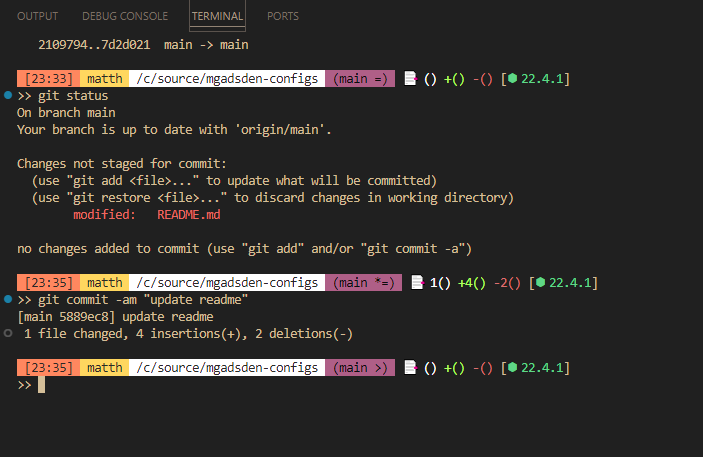
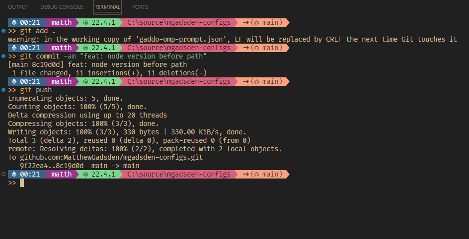
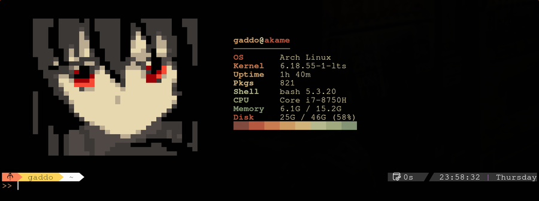

<h1 align="center">
	⚒ mgadsden-configs
</h1>

## Screenshots
<h3 align="center">
	Git Bash Profile
</h3>
<div align="center">
	
</div>

<h3 align="center">
	Oh-My-Posh Profile
</h3>
<div align="center">
	
</div>

<h3 align="center">
	Terminal Greeting
</h3>
<div align="center">
	
</div>

## Themes
### tokyo-snow
A terminal palette sampled from a snowy Tokyo alley wallpaper: warm vending-machine lights fading into green-tinted snow.

It comes in four variants, all with the same colour names and hues. `lamplit-glow` is the default.

| Variant        | Style                                                                  |
|----------------|------------------------------------------------------------------------|
| `lamplit-glow` | `lamplit`'s warm colours with `vending-glow`'s moss and pine (default) |
| `lamplit`      | The wallpaper's own brightest pixels; subtle                           |
| `neon-alley`   | Reds and oranges pushed to the sign glow, slightly darker backgrounds  |
| `vending-glow` | Near-full saturation, deepest backgrounds; loudest                     |

| Name   | `lamplit-glow` | `lamplit` | `neon-alley` | `vending-glow` |
|--------|----------------|-----------|--------------|----------------|
| brick  | `#96402e`      | `#96402e` | `#a8341f`    | `#b8321c`      |
| neon   | `#d5583d`      | `#d5583d` | `#e8492b`    | `#ff4b2b`      |
| ember  | `#db814c`      | `#db814c` | `#f07f3c`    | `#ff8a3d`      |
| amber  | `#e1b568`      | `#e1b568` | `#f2aa4c`    | `#ffb547`      |
| gold   | `#ecd08f`      | `#ecd08f` | `#f4cc72`    | `#ffd56b`      |
| sage   | `#c4c88e`      | `#c4c88e` | `#c9d48a`    | `#d0e08a`      |
| moss   | `#a6d46c`      | `#acbb7f` | `#a9c46f`    | `#a6d46c`      |
| pine   | `#6fc28a`      | `#8fa877` | `#7fae6a`    | `#6fc28a`      |
| snow   | `#f1e4b5`      | `#f1e4b5` | `#f3e6b6`    | `#fff0c2`      |
| dim    | `#7d7860`      | `#7d7860` | `#807a5c`    | `#868063`      |
| night  | `#1c1c1a`      | `#1c1c1a` | `#1a1a17`    | `#161613`      |
| shadow | `#2a2a28`      | `#2a2a28` | `#282823`    | `#24241f`      |
| slate  | `#3a3933`      | `#3a3933` | `#3a382f`    | `#36342b`      |

`night`, `shadow` and `slate` are background tones, `snow` is body text and `dim` is for rules and borders.

Copy `tokyo-snow.theme` to `~/.config/` and `source` it from bash to get a `c_<name>` ANSI escape for each colour (plus `c_text`, `c_muted`, `c_bold` and `c_reset`). To pick a variant, set it before sourcing; the oh-my-posh prompt reads the same variable:

```bash
export TOKYO_SNOW_VARIANT=neon-alley   # lamplit-glow | lamplit | neon-alley | vending-glow
```

`gaddo-omp-prompt.json` uses the tokyo-snow colours too, with all four variants built in as oh-my-posh `palettes`. It uses the version 3 config format, so it needs a recent oh-my-posh (tested with 25.21).

## Terminal Greeting
A startup banner for bash: pixel art on the left, system info (OS, kernel, uptime, packages, shell, CPU, memory, disk) on the right, coloured with the `tokyo-snow` theme.

| Art file            | Style                                            |
|---------------------|--------------------------------------------------|
| `akame-poster.ans`  | Akame, posterized cel-shaded blocks (default)    |
| `akame-color.ans`   | Akame, full-colour blocks                        |
| `akame-outline.ans` | Akame, ASCII line art with red eyes              |
| `sloth.ans`         | Pixel-art sloth                                  |

<details>
<summary>Other art styles</summary>

<h4 align="center">sloth.ans</h4>
<div align="center">
	
</div>
</details>

### Install
```bash
cp tokyo-snow.theme terminal-greeting/*.ans terminal-greeting/sloth-greeting.sh ~/.config/
echo '[[ -f ~/.config/sloth-greeting.sh ]] && bash ~/.config/sloth-greeting.sh' >> ~/.bashrc
```

To switch art, change `sloth_file=` at the top of `sloth-greeting.sh`. The package count uses `pacman`, so it's Arch-specific; the art needs a terminal with 24-bit colour (e.g. kitty).
